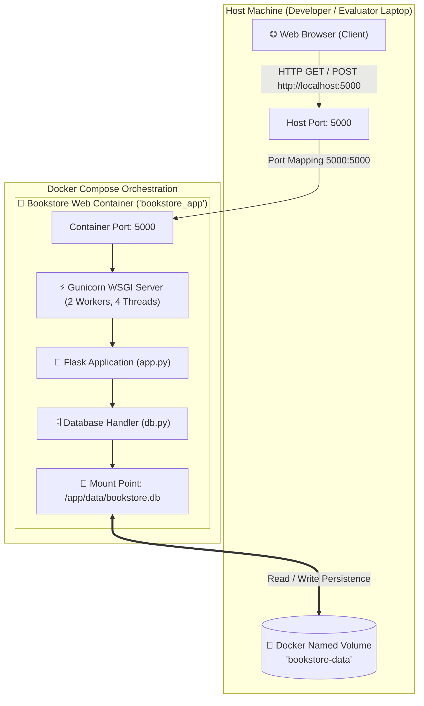

# 📚 Dockerized Online Bookstore Using Docker Compose

[](https://github.com/thanishka1287/devops_project/actions)


An end-to-end, full-stack, containerized web application built for a college-level **DevOps** capstone project. The project demonstrates containerization principles, multi-container orchestration with Docker Compose, automated SQLite persistence across container lifecycles via named volumes, health monitoring, automated Pytest testing, and GitHub Actions CI/CD pipelines.

---

## 📑 Table of Contents

1. [Project Overview](#-project-overview)
2. [Objectives & Pedagogical Value](#-objectives--pedagogical-value)
3. [Key Features](#-key-features)
4. [Technology Stack](#-technology-stack)
5. [System Architecture](#-system-architecture)
6. [Project Folder Structure](#-project-folder-structure)
7. [Docker & Docker Compose Concepts](#-docker--docker-compose-concepts)
8. [Persistent Storage (Named Volumes)](#-persistent-storage-named-volumes)
9. [Prerequisites](#-prerequisites)
10. [Quickstart Guide](#-quickstart-guide)
11. [Essential DevOps Commands](#-essential-devops-commands)
12. [Automated Testing](#-automated-testing)
13. [Continuous Integration (CI/CD)](#-continuous-integration-cicd)
14. [Troubleshooting & Common Errors](#-troubleshooting--common-errors)
15. [Application Walkthrough & Screenshots](#-application-walkthrough--screenshots)
16. [Future Enhancements & Conclusion](#-future-enhancements--conclusion)

---

## 🎯 Project Overview

In traditional software development, running an application on different machines often leads to the infamous *"it works on my machine"* problem. Incompatibilities between operating systems, missing system libraries, or conflicting Python versions cause unpredictable behavior.

This project solves these issues by packaging a complete **Online Bookstore** inside an isolated, lightweight **Docker container**. Orchestrated via **Docker Compose**, the web service, environment configuration, port mappings, and persistent volume mounts are declared as code. Anyone with Docker installed can clone this repository and spin up the entire application using a single command:

```bash
docker compose up --build
```

---

## 🎓 Objectives & Pedagogical Value

The core objectives of this college DevOps demonstration are:

- **Infrastructure as Code (IaC):** Define the deployment environment declaratively via `Dockerfile` and `docker-compose.yml`.
- **Reproducible Environments:** Ensure identical runtime behavior between developer laptops, GitHub Actions CI runners, and production servers.
- **Stateful Containerization:** Demonstrate that containerized applications can persist data safely across container crashes, restarts, and recreation using **Docker Named Volumes**.
- **Container Health Monitoring:** Implement container healthchecks using HTTP probes on a dedicated `/health` endpoint.
- **Automated Quality Gate:** Enforce automated testing with Pytest and continuous image builds in GitHub Actions.

---

## ✨ Key Features

### 🛒 Online Bookstore Features
- **Curated Catalog:** Browse 10 pre-seeded computer science and DevOps books immediately upon startup.
- **Full-Text Search:** Search titles, authors, and keywords dynamically.
- **Category Filtering:** Filter books by categories (*DevOps & Cloud*, *Software Engineering*, *Computer Science*, *Web Development*, *Data Science*).
- **Book Details View:** Inspect extended descriptions, ISBN numbers, stock counters, and pricing.
- **Session-Based Shopping Cart:** Add items, increase/decrease quantities, remove single items, or clear the entire cart.
- **Dynamic Pricing Engine:** Calculates line-item totals and order totals in real-time.
- **Safe Checkout Form:** Validates customer name, email format, and shipping address without needing real payment gateways.
- **Order Confirmation Receipt:** Displays an immutable order reference number, timestamped receipt, and printable confirmation.
- **Responsive UI:** Custom dark-mode typography and responsive layout that adapts to desktops, tablets, and smartphones.

### 🐳 DevOps & Architecture Features
- **Idempotent Database Seeding:** Initializes database tables on startup without creating duplicate entries when containers restart.
- **Isolated SQLite Volume:** SQLite files reside in `/app/data/bookstore.db`, mapped to the `bookstore-data` named volume.
- **Non-Root Execution:** Adheres to container security best practices by running as an unprivileged user (`appuser`).
- **Production WSGI Server:** Serves requests using high-performance multi-worker Gunicorn in production.
- **Healthcheck Probe:** Monitors application health every 30 seconds at `/health`.

---

## 🛠 Technology Stack

| Layer | Technology | Purpose |
| :--- | :--- | :--- |
| **Frontend** | HTML5, CSS3, Vanilla JavaScript | Responsive catalog, styled book covers, shopping cart UI, form validation |
| **Backend** | Python 3.11 + Flask 3.1 | REST routing, Jinja templating, session cart management, database interaction |
| **WSGI Server** | Gunicorn 23.0 | Production-grade multi-process WSGI server for container runtime |
| **Database** | SQLite 3 | Embedded relational database (`books`, `orders`, `order_items` tables) |
| **Containerization** | Docker | Packaging application, dependencies, and OS binaries into an immutable image |
| **Orchestration** | Docker Compose | Managing services, port forwarding, named volume mapping, and environment variables |
| **Testing** | Pytest 8.3+ | 14 automated unit and integration tests with isolated temporary databases |
| **CI/CD** | GitHub Actions | Automated build, test, and container packaging on every push and pull request |

---

## 📐 System Architecture

The following diagram illustrates how user requests travel through the host machine, container network, and storage volumes:



---

## 📂 Project Folder Structure

```text
devops_project/
├── .github/
│   └── workflows/
│       └── ci.yml             # GitHub Actions CI pipeline (Pytest + Docker build)
├── data/
│   └── .gitkeep               # Directory placeholder (bookstore.db created at runtime)
├── static/
│   ├── css/
│   │   └── style.css          # Responsive dark-theme styling, book cards, buttons
│   └── js/
│       └── app.js            # Client-side validation, flash message timers
├── templates/
│   ├── base.html              # Core layout template (header, navbar, footer)
│   ├── index.html             # Catalog browsing, search bar, category filters
│   ├── book_detail.html       # Single book view with quantity selector
│   ├── cart.html              # Interactive shopping cart and total calculator
│   ├── checkout.html          # Shipping form with validation
│   ├── confirmation.html      # Order receipt with order number & item list
│   ├── 404.html               # Custom 404 Not Found error page
│   └── 500.html               # Custom 500 Server Error page
├── tests/
│   ├── __init__.py            # Test package marker
│   ├── conftest.py            # Pytest fixtures and isolated temporary test DB
│   └── test_app.py            # 14 automated test cases
├── .dockerignore              # Files excluded from Docker build context
├── .gitignore                # Files excluded from Git version control
├── app.py                     # Flask application factory, routes, and controllers
├── db.py                      # SQLite database schema, connections, and seeder
├── Dockerfile                 # Multi-stage production container build instructions
├── docker-compose.yml         # Container configuration, volumes, and ports
├── requirements.txt           # Python dependencies
└── README.md                  # Comprehensive project documentation
```

---

## 🐳 Docker & Docker Compose Concepts

### 1. What is the `Dockerfile`?
The `Dockerfile` is a text recipe that tells Docker how to build the container image:
- **Base Image:** `FROM python:3.11-slim` ensures minimal image footprint.
- **Layer Caching:** Copies `requirements.txt` and runs `pip install` before copying application code. Subsequent code modifications rebuild instantly without re-downloading packages.
- **Security:** Creates and switches to a non-root `appuser`.
- **Healthcheck:** Periodically executes a Python HTTP request against `/health`.

### 2. What is `docker-compose.yml`?
While `docker build` and `docker run` require lengthy CLI arguments, `docker-compose.yml` codifies everything:
- Builds image automatically (`build: .`).
- Maps host port `5000` to container port `5000`.
- Attaches the persistent volume `bookstore-data:/app/data`.
- Automatically sets restart policy `unless-stopped`.

---

## 💾 Persistent Storage (Named Volumes)

By default, Docker containers are **ephemeral**—any files created or modified inside a container disappear when the container is deleted.

To prevent database loss, this project uses a **Docker Named Volume**:

```yaml
volumes:
  - bookstore-data:/app/data
```

### How to Verify Persistence in Your College Demo:
1. Start the application:
   ```bash
   docker compose up -d
   ```
2. Open `http://localhost:5000`, add a book to your cart, and place an order.
3. Stop and remove the active container:
   ```bash
   docker compose down
   ```
4. Recreate the container:
   ```bash
   docker compose up -d
   ```
5. Notice that your placed orders and database records are **still there**! The data survived complete container destruction because it was stored safely inside the `bookstore-data` volume.

---

## 📋 Prerequisites

Before running the project, ensure you have:
- **Docker Desktop** installed and running on Windows, macOS, or Linux.
  - Download from: [https://www.docker.com/products/docker-desktop/](https://www.docker.com/products/docker-desktop/)
- **Git** installed on your system.
- *(Optional for local development without Docker)* **Python 3.10+**.

---

## 🚀 Quickstart Guide

### Option 1: Run with Docker Compose (Recommended)

1. **Clone the repository:**
   ```bash
   git clone https://github.com/thanishka1287/devops_project.git
   cd devops_project
   ```

2. **Build and start the container:**
   ```bash
   docker compose up --build
   ```

3. **Access the application:**
   Open your browser and navigate to:
   ```text
   http://localhost:5000
   ```

4. **Verify container health:**
   ```text
   http://localhost:5000/health
   ```

---

### Option 2: Run with Standalone Docker

If you prefer using pure Docker CLI without Compose:

```bash
# 1. Build the Docker image
docker build -t devops-bookstore:v1 .

# 2. Create a persistent volume
docker volume create bookstore-data

# 3. Run the container
docker run -d \
  --name bookstore_container \
  -p 5000:5000 \
  -v bookstore-data:/app/data \
  devops-bookstore:v1

# 4. View running container
docker ps
```

---

### Option 3: Run Locally (Without Docker)

For quick debugging or development:

```bash
# 1. Create a virtual environment
python -m venv .venv

# 2. Activate virtual environment
# Windows:
.venv\Scripts\activate
# Linux/macOS:
source .venv/bin/activate

# 3. Install dependencies
pip install -r requirements.txt

# 4. Run the application
python app.py
```
Open `http://localhost:5000` in your browser.

---

## 💻 Essential DevOps Commands

| Task | Command | Description |
| :--- | :--- | :--- |
| **Build & Start** | `docker compose up --build` | Builds image if changed and starts containers with live console logs |
| **Start in Background** | `docker compose up -d` | Runs containers in detached (background) mode |
| **Stop Services** | `docker compose down` | Stops and removes containers while keeping volume data safe |
| **View Live Logs** | `docker compose logs -f` | Follows real-time standard output and HTTP request logs |
| **Inspect Status** | `docker compose ps` | Checks container status, uptime, health, and open ports |
| **Restart Container** | `docker compose restart` | Restarts container without rebuilding |
| **Execute Shell Inside** | `docker compose exec web bash` | Opens an interactive bash shell inside the running container |
| **Inspect Volumes** | `docker volume ls` | Lists all local Docker volumes including `devops_project_bookstore-data` |
| **Tear Down Everything** | `docker compose down -v` | ⚠️ Stops containers AND purges persistent database volume |

---

## 🧪 Automated Testing

The project includes a comprehensive automated test suite powered by **Pytest**, covering 14 unit and integration test scenarios:

### Test Coverage Highlights:
- ✅ **Homepage & Branding:** Confirms homepage loads with status code 200 and renders the navigation banner.
- ✅ **Catalog Display:** Verifies sample books load from SQLite into the DOM.
- ✅ **Search Functionality:** Validates querying by book title and author name.
- ✅ **Category Filtering:** Tests single-category filtering logic.
- ✅ **Empty Search State:** Checks user-friendly warning when queries yield no results.
- ✅ **Book Details:** Tests valid book detail routes and 404 error responses for invalid IDs.
- ✅ **Shopping Cart Lifecycle:** Tests adding items, increasing quantity, decreasing quantity, and removing items.
- ✅ **Checkout Form Validation:** Tests input rejection for missing names, addresses, and invalid emails.
- ✅ **Database Persistence:** Confirms that placing an order inserts valid rows into `orders` and `order_items` tables.
- ✅ **Health Endpoint:** Verifies `/health` returns HTTP 200 and healthy JSON status.
- ✅ **Idempotent DB Seeding:** Ensures that repeated application boots never duplicate seed records.

### Running the Tests:

```bash
# Run all tests with verbose output
pytest -v tests
```

---

## 🔄 Continuous Integration (CI/CD)

The repository includes a production-grade **GitHub Actions** workflow defined in [`.github/workflows/ci.yml`](.github/workflows/ci.yml).

Every time code is pushed to branch `main` or a pull request is opened, the automated workflow triggers two concurrent stages:

```text
[ Git Push to main ]
         │
         ▼
 ┌───────────────┐
 │ Job 1: Test   │ ──► Installs dependencies & runs 14 Pytest test cases
 └───────┬───────┘
         │ (On Success)
         ▼
 ┌───────────────────────┐
 │ Job 2: Docker Build   │ ──► Builds Docker image & validates /health endpoint
 └───────────────────────┘
```

This guarantees that broken code or unbuildable Docker configurations can never be committed unnoticed.

---

## 🛠 Troubleshooting & Common Errors

### 1. Port 5000 Already in Use
**Error:** `bind: address already in use` or `Ports are not available: exposing port TCP 0.0.0.0:5000 -> 0.0.0.0:0: listen tcp 0.0.0.0:5000: bind: Only one usage of each socket address is normally permitted.`
**Fix:** Another process is using port 5000 (e.g., Apple AirPlay Receiver on macOS or another web server on Windows).
In `docker-compose.yml`, change the host port mapping to another port like `5001:5000`:
```yaml
ports:
  - "5001:5000"
```
Then visit `http://localhost:5001`.

### 2. Resetting the Database to Default Sample Data
If you want to clear out test orders and restore the original seed data:
```bash
docker compose down -v
docker compose up --build
```
The `-v` flag removes the named volume so the database recreates cleanly on next boot.

### 3. Viewing Error Logs
If an unhandled error occurs, inspect the container logs:
```bash
docker compose logs -f web
```

---

## 📸 Application Walkthrough & Screenshots

### 1. Homepage & Curated Catalog
Displays modern book cards with dynamic color covers, category tags, author info, live pricing, search bar, and category filters.
> *Placeholder: `docs/screenshots/homepage.png`*
> 

### 2. Interactive Shopping Cart
Shows added books with quantity increment/decrement controls, live price recalculations, and checkout prompt.
> *Placeholder: `docs/screenshots/cart.png`*
> 

### 3. Checkout & Order Confirmation
Captures student delivery details, inserts order rows into the SQLite database volume, and displays a printable receipt with order reference.
> *Placeholder: `docs/screenshots/confirmation.png`*
> 

---

## 🚀 Future Enhancements & Conclusion

### Summary
This project demonstrates the core pillars of modern DevOps:
1. **Containerization** with Docker to eliminate environment drift.
2. **Orchestration** with Docker Compose to coordinate configuration, ports, and volumes.
3. **Data Persistence** with Docker Named Volumes.
4. **Automated Verification** with Pytest and GitHub Actions CI.

### Potential Future Improvements
- **Multi-Container Separation:** Migrate SQLite to a dedicated PostgreSQL or MySQL container service within `docker-compose.yml`.
- **Reverse Proxy:** Add an Nginx container as a reverse proxy for SSL termination and static asset caching.
- **Monitoring & Metrics:** Integrate Prometheus and Grafana to capture real-time HTTP metrics and container CPU/memory usage.

---

**Developed for College DevOps Coursework**  
Author: [thanishka1287](https://github.com/thanishka1287)  
Repository: [https://github.com/thanishka1287/devops_project](https://github.com/thanishka1287/devops_project)
